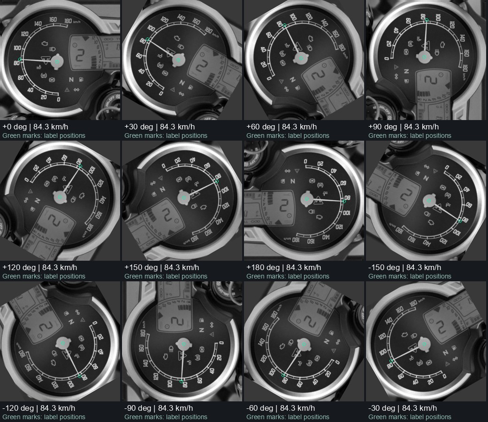

# Triumph speedometer synthetic dataset

Grayscale dashboard images with speed and needle-position labels for a Triumph Scrambler 400 XC speedometer reader. Version 2 adds clockwise and counterclockwise camera rotations over the full circle, including sideways and upside-down views. Generation uses OpenCV locally, with no per-image AI generation cost.

## Download and train

- [Open the latest notebook in Google Colab](https://colab.research.google.com/github/sainadh812/triumph-speedometer-dataset/blob/main/Speedometer_Training_Colab.ipynb)
- [Version 2 dataset ZIP](https://github.com/sainadh812/triumph-speedometer-dataset/releases/download/v2.0.0/speedometer_bw_rotation_v2.zip)
- [SHA-256 checksum](https://github.com/sainadh812/triumph-speedometer-dataset/releases/download/v2.0.0/speedometer_bw_rotation_v2.zip.sha256)
- [Version 2 release](https://github.com/sainadh812/triumph-speedometer-dataset/releases/tag/v2.0.0)
- [Original 500-image dataset](https://github.com/sainadh812/triumph-speedometer-dataset/releases/tag/v1.0.0) and [preserved baseline notebook](Speedometer_Baseline_500_Colab.ipynb)

The public dataset is a release asset; cloning the repository does not download images. The notebook downloads and verifies the archive automatically. Select a T4 GPU and Run all, then authorize the Drive mount if prompted. Existing Drive notebook copies do not automatically receive GitHub changes.

## Images and labels

| Set | Images | Angles | Use |
|---|---:|---|---|
| Training | 4,800 | 12 angles, 30-degree intervals | Update model weights |
| Validation | 1,200 | Same 12 angles, different pose groups | Select best checkpoint and stop early |
| Intermediate-angle robustness | 1,200 | 15-degree offsets between training angles | Before/after evaluation only |

All inputs are 512 x 512 single-channel PNGs. Version 2 retains the 500 original images byte-for-byte at zero rotation and creates 5,500 additional main-set images plus 1,200 robustness images. Positive rotation angles are clockwise relative to the parent image.

Each transformation rotates the entire dashboard image, needle mask, pivot, tip, tick anchor and source-to-image homography together. **Speed does not change when the camera rotates.** Keypoint coordinates use zero-based pixel centers, normalized by dividing by 511. Labels include parent sample ID, original pose group, split, rotation angle and image hashes. All descendants inherit their parent's split. No validation parent enters training.

Rotation uses a fixed 512-pixel canvas without rescaling. Outer hardware corners can leave the crop, while all labeled needle points and calibrated tick anchors remain inside. Missing corner pixels use constant gray based on the parent image's edge median; no reflected markings or needles are invented. Real-camera testing must check whether these synthetic borders create a shortcut.

Green overlay marks are for inspection only and absent from model inputs. The archive is rooted at `bw_dataset_rotation_v2/`; its `robustness/` directory contains a separate validation-only manifest. Metadata is in [rotation_metadata](rotation_metadata/), and the generator is in [rotation_dataset](rotation_dataset/).

## Model and continuation

The existing MobileNetV3-Small encoder, needle heatmap decoder and learned speed head are retained. Grayscale pixels are repeated into three channels and ImageNet-normalized. This update adds rotation training and evaluation; it does not add a ring detector or analytic angle-to-speed reader. A circular ring alone does not identify upright orientation; geometric reading also needs calibrated tick references.

The notebook defaults to a **new experiment initialized from private best epoch-47 weights**. That model achieved 2.159 km/h MAE and 62% within +/-2 km/h on the original 100 synthetic validation images. Those figures are historical, not rotation-training results.

The optimizer and random state reset once for this changed dataset. Source weights are evaluated on the new validation set before any update, and retained if no new checkpoint improves MAE. New experiment epochs run 0 to 20, with source epoch 47 recorded separately. The original experiment is preserved.

Every completed epoch saves full state to Google Drive. Choose `resume_latest` after a disconnect, `resume_best` to rewind to the best complete state, or `fresh` with a new experiment name to ignore previous weights. Rerunning a completed experiment does not silently add epochs. Trained weights remain private in Drive; other repository users should choose `fresh` and a new experiment name.

Before/after reports separate original upright images, rotated images, every main angle, and intermediate angles excluded from checkpoint selection. See [training instructions](training_pilot/README.md).

## Provenance and evaluation limits

All images descend from one approved AI reconstruction based on the dashboard photograph supplied during development. The original photograph's website, author and license are not recorded in available project files. No new license for underlying imagery is asserted, and this project is not affiliated with Triumph.

The obscured 60 km/h calibration anchor remains inferred. Exact 0 and 180 km/h examples are training-only. Rotations add variation, not independent scenes: validation and robustness still use the same 50 held-out synthetic pose groups, and all sets share one dashboard master. Intermediate-angle results are a robustness diagnostic, not an independent real test.

The target of 98% of readable frames within +/-2 km/h requires independently labeled real dashboard recordings. Real-camera accuracy is unmeasured. The model assumes a suitable dashboard crop; it has no dashboard detector or unreadable-frame detector.
