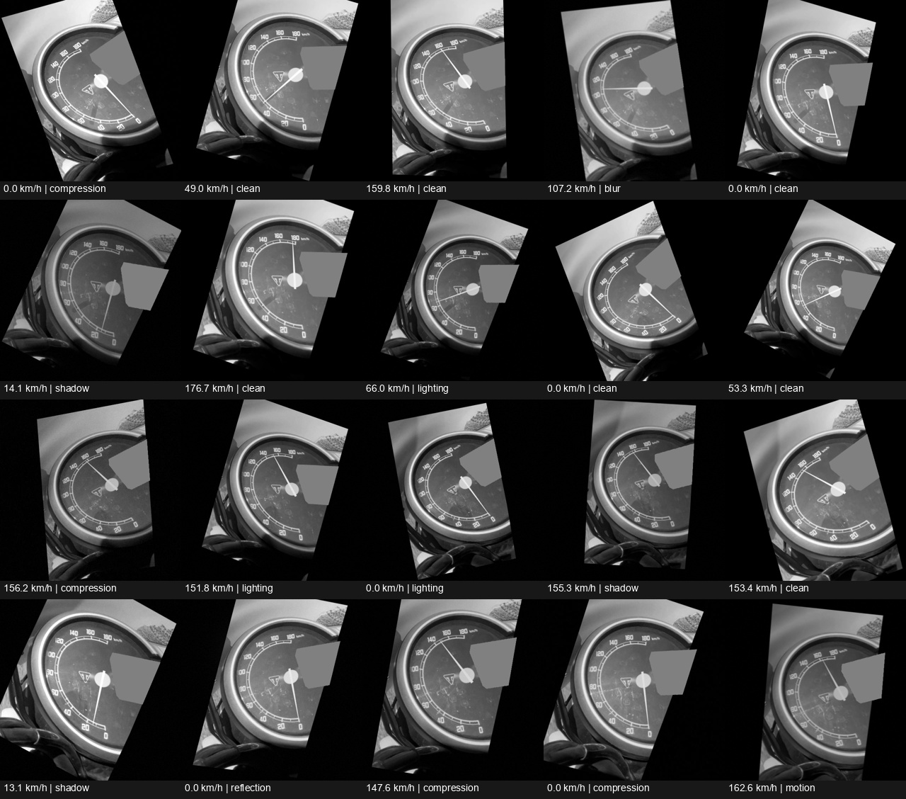
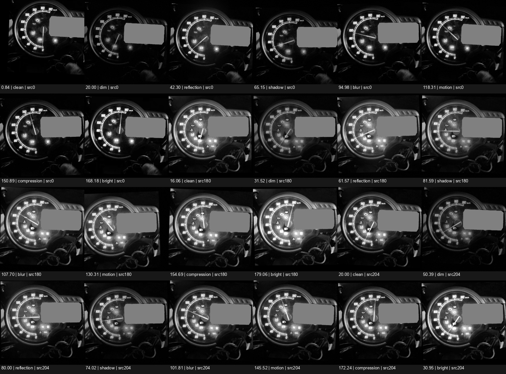
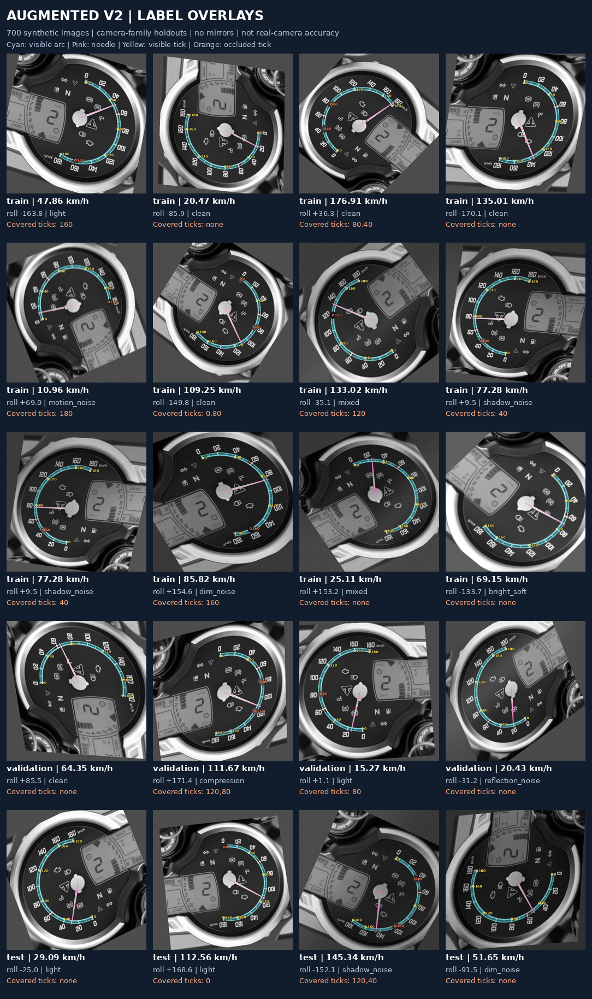
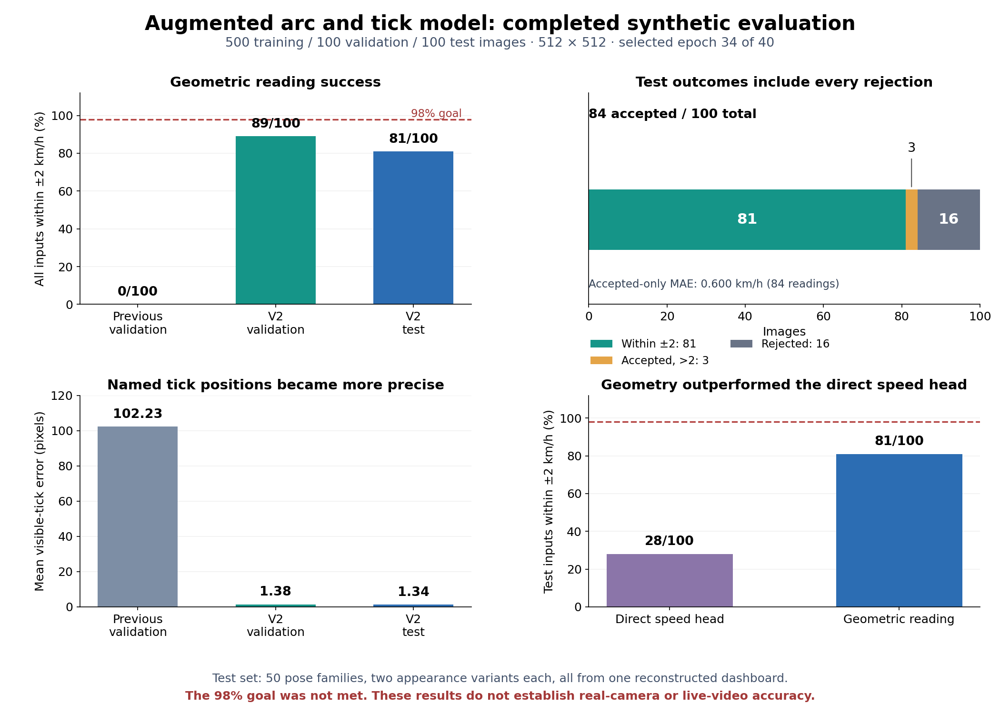
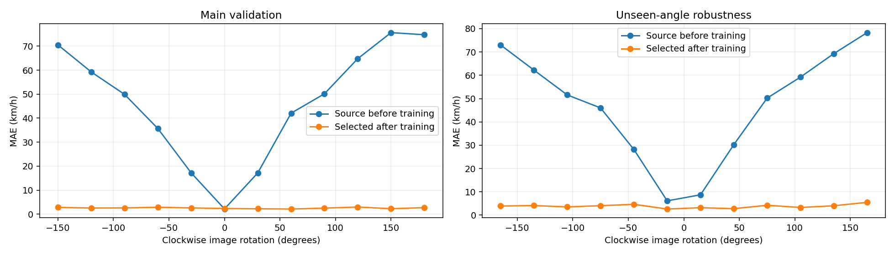

# Triumph speedometer synthetic dataset

## Mixed camera views V5

[V5](mixed_view_v5/README.md) combines the reviewed straight and daytime datasets into **7,500 masked, labeled 512×512 images** with left, straight and right camera-roll variants. Balanced batches cover both source views; all 12 landmarks move with the image. The input pipeline preserves the video orientation and projects only the LCD mask. Training and before/after testing of both videos run in Colab, with full checkpoints saved every epoch to Drive.

[Open the V5 Colab notebook](https://colab.research.google.com/github/sainadh812/triumph-speedometer-dataset/blob/main/mixed_view_v5/Triumph_Mixed_Views_V5_Colab.ipynb) · [Verified dataset download](mixed_view_v5/data_download_manifest.json)

These remain same-recording development examples and tests; independent real-world accuracy is unverified.

## RPM training pilot

The [RPM Colab notebook](https://colab.research.google.com/github/sainadh812/triumph-speedometer-dataset/blob/main/rpm_training_v1/Triumph_RPM_Training_V1_Colab.ipynb) trains a separate small CNN on **2,000 OpenCV-generated LCD-bar images**, with gear/trip regions masked. It saves every epoch to Drive and supports fresh/latest/best/explicit restart modes. [Dataset, calibration limits and setup](rpm_training_v1/README.md). Approximate synthetic RPM labels are not measured engine RPM; independent real accuracy remains unverified.

Grayscale dashboard images with speed and needle-position labels for a Triumph Scrambler 400 XC speedometer reader. Version 2 adds clockwise and counterclockwise camera rotations over the full circle, including sideways and upside-down views. Generation uses OpenCV locally, with no per-image AI generation cost.

## Daytime joint needle and tick model V4

The [V4 experiment](real_adaptation_v4/README.md) adds **2,000 masked grayscale images at 512×512** from the daytime dashboard video: 1,600 training and 400 development-validation images. The LCD mask is fitted to the actual daytime view. Frames are aligned to that reference before the fixed mask is applied, keeping the needle, hub and speed scale clear.

[Open the V4 Colab notebook](https://colab.research.google.com/github/sainadh812/triumph-speedometer-dataset/blob/main/real_adaptation_v4/Speedometer_Joint_Landmarks_V4_Colab.ipynb) · [Verified multipart dataset download](real_adaptation_v4/data_download_manifest.json)

The model predicts the needle pivot and tip plus ten semantic ticks. Speed uses those predicted points. Training transfers the verified V3 needle weights and saves full state to Drive every epoch. This is a same-video adaptation experiment; validation results do not establish independent real-video accuracy.

## Real dashboard adaptation V3

The latest [needle adaptation experiment](real_adaptation_v3/README.md) addresses poor detections on the fixed-camera night video. It adds **500 grayscale 512×512 images**, generated from approved real-dial background repairs with a masked LCD, varied lighting/blur, and framing shifts. There are 400 training images and 100 validation images from a held-out source plate. All source plates share the same video, so this is a development check rather than an independent real test.

[Open the V3 Colab notebook](https://colab.research.google.com/github/sainadh812/triumph-speedometer-dataset/blob/main/real_adaptation_v3/Speedometer_Real_Adaptation_V3_Colab.ipynb) · [Dataset archive](real_adaptation_v3/real_dashboard_lcd_mask_500_v3.zip) · [Checksums and QA](real_adaptation_v3/dataset500_manifest.json)

This experiment unfreezes the existing needle decoder and the last four encoder blocks. It calculates indicated speed from predicted needle endpoints and a manually calibrated reference dial, using image-only registration. The private run adds ten approved real training frames and reports before/after predictions on nine other frames from the same video. Private frames, original video, and model weights remain off GitHub. The notebook saves every completed epoch to Drive and supports transfer, latest, best, and fresh modes.

## Augmented arc and tick experiment

The new [augmented training notebook](https://colab.research.google.com/github/sainadh812/triumph-speedometer-dataset/blob/main/ring_training_v2/Speedometer_Arc_Ticks_Augmented_Colab.ipynb) uses **500 training, 100 validation and 100 test images at 512×512**. The [69 MB archive](ring_training_v2/arc_needle_augmented700.zip) is downloaded automatically and verified. [Setup, metrics and restart notes](ring_training_v2/README.txt) explain the full workflow.

The dataset adds translation, mild shear, perspective, continuous full-circle rotation, blur, lighting/noise and controlled tick occlusion. Related appearance variants stay in the same split. Mirrors are disabled. A dedicated multiscale tick decoder learns named references; a separate frozen needle branch preserves the earlier needle reader. All labels and masks follow the image transform.

Training starts from the owner's private arc epoch33 and needle epoch19 weights in a separate experiment; others can select `fresh`. Every epoch saves complete state to Drive, with latest/best/fresh modes. The 40-epoch schedule selects checkpoints using validation only. Final synthetic test evaluation is opt-in after model decisions are finished. This is a shared-source synthetic holdout and cannot establish real-camera accuracy.

[Dataset checks and provenance](ring_training_v2/dataset_manifest.json) · [Validation report](ring_training_v2/dataset_metadata/validation_report.json) · [Reproducible generator](ring_training_v2/generate_dataset.py)

## Completed augmented arc and tick experiment

The 40-epoch experiment completed on **2026-10-17**. Validation selected **epoch 34**; the final test was evaluated after selection. The test contains 100 images from 50 pose families, with two appearance variants per family.

| Metric | Previous model, validation | Selected V2, validation | Selected V2, test |
|---|---:|---:|---:|
| Geometry within ±2 km/h, all inputs | 0/100 | 89/100 | **81/100** |
| Accepted geometric readings | 0/100 | 90/100 | 84/100 |
| Geometric MAE, accepted readings only | — | 0.522 km/h | 0.600 km/h |
| Mean visible-tick error | 102.23 px | 1.38 px | 1.34 px |
| Arc IoU | 0.697 | 0.924 | 0.923 |
| Visibility balanced accuracy | 50.00% | 90.82% | 81.24% |
| Direct speed head within ±2 km/h | 19/100 | 31/100 | 28/100 |

**The 98% target was not met.** On the test set, 81 readings were within ±2 km/h, three accepted readings exceeded that tolerance, and 16 readings were rejected. The accepted-only MAE excludes those 16 rejections. Geometric reading was more useful than the direct speed head, but these results still leave failures to address.

The previous-model column uses the earlier arc model. V2 adds the dedicated tick decoder and restores the separate epoch-19 needle branch; the needle improvement includes that branch replacement. All sets share one reconstructed dashboard, so this synthetic holdout does not establish real-camera or live-video accuracy.

An independent results-archive audit verified all 40 history epochs, best epoch 34, final-test reports, and exact preservation of all 258 frozen needle tensors. Drive checks confirmed 41 completed checkpoint markers, including epoch zero, with matching file sizes. Weights and private paths remain unpublished. [Exact results, provenance and audit scope](results/arc_ticks_augmented_v2/results_summary.json) include the limitations of the compact archive audit.

[Forty-epoch validation learning curve](results/arc_ticks_augmented_v2/tick_learning.png) · [Twenty synthetic test examples with predictions](results/arc_ticks_augmented_v2/test_predictions.png). These examples are an inspection sample; the reported test metrics use all 100 test images.

## Download and train

- [Arc + needle learning-check notebook](https://colab.research.google.com/github/sainadh812/triumph-speedometer-dataset/blob/main/ring_training/Speedometer_Arc_Needle_Colab.ipynb) — new development pilot described below
- [Open the version-2 rotation notebook in Google Colab](https://colab.research.google.com/github/sainadh812/triumph-speedometer-dataset/blob/main/Speedometer_Training_Colab.ipynb)
- [Version 2 dataset ZIP](https://github.com/sainadh812/triumph-speedometer-dataset/releases/download/v2.0.0/speedometer_bw_rotation_v2.zip)
- [SHA-256 checksum](https://github.com/sainadh812/triumph-speedometer-dataset/releases/download/v2.0.0/speedometer_bw_rotation_v2.zip.sha256)
- [Version 2 release](https://github.com/sainadh812/triumph-speedometer-dataset/releases/tag/v2.0.0)
- [Original 500-image dataset](https://github.com/sainadh812/triumph-speedometer-dataset/releases/tag/v1.0.0) and [preserved baseline notebook](Speedometer_Baseline_500_Colab.ipynb)

The large version-2 dataset is a release asset; cloning the repository does not download that dataset. Its notebook downloads and verifies the archive automatically. Select a T4 GPU and Run all, then authorize the Drive mount if prompted. Existing Drive notebook copies do not automatically receive GitHub changes.

## Arc and named-tick development pilot

The separate [arc/needle notebook](ring_training/Speedometer_Arc_Needle_Colab.ipynb) extends the rotation model with six named tick heatmaps, tick visibility and a full-resolution scale-arc mask. An explicit migration copies all existing speed/needle tensors from private best rotation epoch 19 and initializes only the new branches. The new model uses a separate experiment and saves every completed epoch to Drive, with latest/best/fresh modes.

This first learning check uses the same **20 review images at 512 × 512 for training and evaluation**. It is not a held-out accuracy test. The [review archive](ring_training/arc_needle_review20.zip) includes speed, needle endpoints, named ticks, arc/ignore masks and transformation provenance. This small archive is included in the repository; the larger version-2 dataset remains a release asset. The inferred 60 km/h region stays excluded from reliable arc supervision.

Geometric speed uses predicted tick positions, predicted visibility and predicted needle endpoints. Ground-truth landmarks and known camera transforms never enter image-based geometric inference. Reports include rejected readings in all-input success rates, so a small accepted subset cannot conceal failures. See [setup and evaluation notes](ring_training/README.txt). This pilot does not establish real-camera accuracy or replace the completed version-2 evaluation below.

## Images and labels

| Set | Images | Angles | Use |
|---|---:|---|---|
| Training | 4,800 | 12 angles, 30-degree intervals | Update model weights |
| Validation | 1,200 | Same 12 angles, different pose groups | Select best checkpoint and stop early |
| Intermediate-angle robustness | 1,200 | 15-degree offsets between training angles | Before/after evaluation only |

All inputs are 512 x 512 single-channel PNGs. Version 2 retains the 500 original images byte-for-byte at zero rotation and creates 5,500 additional main-set images plus 1,200 robustness images. Positive rotation angles are clockwise relative to the parent image.

Each transformation rotates the entire dashboard image, needle mask, pivot, tip, tick anchor and source-to-image homography together. **Speed does not change when the camera rotates.** Keypoint coordinates use zero-based pixel centers, normalized by dividing by 511. Labels include parent sample ID, original pose group, split, rotation angle and image hashes. All descendants inherit their parent's split. No validation parent enters training.

Rotation uses a fixed 512-pixel canvas without rescaling. Outer hardware corners can leave the crop, while all labeled needle points and calibrated tick anchors remain inside. Missing corner pixels use constant gray based on the parent image's edge median; no reflected markings or needles are invented. Real-camera testing must check whether these synthetic borders create a shortcut.

Green overlay marks are for inspection only and absent from model inputs. The archive is rooted at `bw_dataset_rotation_v2/`; its `robustness/` directory contains a separate validation-only manifest. Metadata is in [rotation_metadata](rotation_metadata/), and the generator is in [rotation_dataset](rotation_dataset/).

## Model and continuation

The existing MobileNetV3-Small encoder, needle heatmap decoder and learned speed head are retained. Grayscale pixels are repeated into three channels and ImageNet-normalized. This update adds rotation training and evaluation; it does not add a ring detector or analytic angle-to-speed reader. A circular ring alone does not identify upright orientation; geometric reading also needs calibrated tick references.

The notebook defaults to a **new experiment initialized from private best epoch-47 weights**. That model achieved 2.159 km/h MAE and 62% within +/-2 km/h on the original 100 synthetic validation images. Those figures are historical, not rotation-training results.

The optimizer and random state reset once for this changed dataset. Source weights are evaluated on the new validation set before any update, and retained if no new checkpoint improves MAE. New experiment epochs run 0 to 20, with source epoch 47 recorded separately. The original experiment is preserved.

Every completed epoch saves full state to Google Drive. Choose `resume_latest` after a disconnect, `resume_best` to rewind to the best complete state, or `fresh` with a new experiment name to ignore previous weights. Rerunning a completed experiment does not silently add epochs. Trained weights remain private in Drive; other repository users should choose `fresh` and a new experiment name.

Before/after reports separate original upright images, rotated images, every main angle, and intermediate angles excluded from checkpoint selection. See [training instructions](training_pilot/README.md).

## Completed rotation experiment

The 20-epoch T4 run completed on 2026-10-17, starting from source epoch 47. New epoch **19** was selected by lowest main-validation MAE; epoch 20 remains available as the latest full training state in private Drive storage.

| Synthetic evaluation | Images | MAE before → after (km/h) | Within ±2 km/h before → after |
|---|---:|---:|---:|
| All main validation | 1,200 | 46.62 → 2.54 | 6.92% → 47.58% |
| Original upright views | 100 | 2.16 → 2.34 | 62.00% → 47.00% |
| Rotated main views | 1,100 | 50.66 → 2.56 | 1.91% → 47.64% |
| Unseen intermediate angles | 1,200 | 46.93 → 3.82 | 3.67% → 33.25% |

Rotation handling improved substantially, with an upright-performance regression and a remaining gap at unseen angles. **The 98% within ±2 km/h target was not achieved.** Main and unseen-angle 95th-percentile absolute errors are 6.30 and 9.69 km/h. Main-grid 180° MAE improved from 74.77 to 2.69 km/h; unseen 165° remains the weakest angle at 5.50 km/h MAE and 18% within ±2 km/h.

The downloaded model, provenance hashes, prediction CSVs and before/after comparisons passed an independent local audit. Source predictions were reproduced against the separately evaluated CPU baseline, and the selected model passed three CPU inference replay checks. These checks validate the artifacts; they do not establish real-camera accuracy. Full resumable checkpoints and model weights remain private.

See [aggregate results and provenance](results/rotation_v2_pilot/results_summary.json), [all angle comparisons](results/rotation_v2_pilot/rotation_comparison.csv), [training history](results/rotation_v2_pilot/training_history.csv), and [worst predictions](results/rotation_v2_pilot/worst_predictions.csv).

## Provenance and evaluation limits

The earlier datasets descend from one approved AI reconstruction based on the dashboard photograph supplied during development. V3 instead uses repaired dashboard frames from the user's night video; its provenance is recorded separately. The original internet photograph's website, author and license are not recorded in available project files. No new license for underlying imagery is asserted, and this project is not affiliated with Triumph.

The obscured 60 km/h calibration anchor remains inferred. In the earlier rotation dataset, exact 0 and 180 km/h examples are training-only; its validation and robustness sets use the same 50 held-out synthetic pose groups. The augmented arc/tick dataset instead has 50 validation and 50 test pose families. All sets share one dashboard master, so added variations are not independent real scenes. Intermediate-angle results are a robustness diagnostic, not an independent real test.

The target of 98% of readable frames within +/-2 km/h requires independently labeled real dashboard recordings. Real-camera accuracy is unmeasured. The model assumes a suitable dashboard crop; it has no dashboard detector or unreadable-frame detector.
