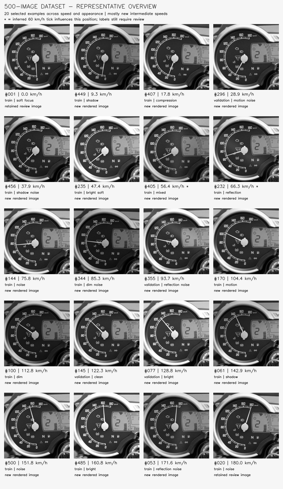

# Triumph speedometer synthetic dataset

A 500-image grayscale pilot dataset for reading a Triumph Scrambler 400 XC analog speedometer. Images were produced from one approved, ImageGen-reconstructed dashboard source using programmatic needle placement and lighting, noise, blur, and perspective variations.

## Download

- [Dataset ZIP: speedometer_bw500.zip](https://github.com/sainadh812/triumph-speedometer-dataset/releases/download/v1.0.0/speedometer_bw500.zip) (101,114,641 bytes)
- [SHA-256 checksum](https://github.com/sainadh812/triumph-speedometer-dataset/releases/download/v1.0.0/speedometer_bw500.zip.sha256)
- [Release page](https://github.com/sainadh812/triumph-speedometer-dataset/releases/tag/v1.0.0)

The public ZIP is a release asset; cloning the repository does not download the dataset. No GitHub sign-in is required to download it. The Colab notebook downloads this asset automatically.

Dataset SHA-256:

```text
92e773ec1ccee15a455a78453e8e5cfe81d04e2d93a57ff83fcea807b6ab3e27
```

## Contents

| Item | Description |
|---|---|
| Model inputs | 500 single-channel PNG images, 512 x 512 pixels |
| Training split | 400 images |
| Validation split | 100 images from 50 pose groups |
| Labels | Speed in km/h; needle pivot and tip in pixel and normalized coordinates; geometry and generation metadata |
| Other assets | 500 needle masks, frozen source assets, calibration, split files, generator scripts, validation report, and previews |

The approved first 20 images are retained. The remaining 480 images contain two variants of each of 240 new poses. Pose groups and exact speeds do not cross the training/validation split. All examples share the same reconstructed source dashboard.

Labels and audit metadata are available in [dataset_metadata](dataset_metadata/). The archive contains the full JSON labels and all supporting files, with paths rooted at `bw_dataset_500/`.



## Train in Google Colab

1. Open the [training notebook directly in Google Colab](https://colab.research.google.com/github/sainadh812/triumph-speedometer-dataset/blob/main/Speedometer_Training_Colab.ipynb).
2. Choose **Runtime > Change runtime type > T4 GPU**, then **Run all**.
3. The notebook automatically downloads `speedometer_bw500.zip` from the public GitHub release and verifies its SHA-256 checksum before extraction. It reuses a cached ZIP only when its checksum matches.
4. Keep the generated results ZIP after the experiments finish.

An existing notebook saved in Google Drive is a separate copy and does not automatically receive these changes. Open the GitHub notebook link above to use the updated download code; save a new copy to Drive if desired.

The self-contained notebook trains MobileNetV3-Small with speed regression and supervised needle pivot/tip heatmaps. It compares nested subsets of 100, 250, and 400 training images using the same 100 validation images. The default input remains 512 x 512 grayscale, repeated across three channels for pretrained-weight compatibility.

See [training instructions](training_pilot/README.md) for configuration, metrics, and inference details. Local software checks covered data/label integrity, gradients, pretrained 512-pixel inference, and a small end-to-end notebook run. A full Colab GPU training run has not yet been verified.

## Provenance and evaluation limits

The approved source is an AI reconstruction based on the dashboard photograph supplied during development. The original photograph's website, author, and license are not recorded in the available project files. No new license for the underlying imagery is asserted here, and this project is not affiliated with Triumph.

The 60 km/h calibration anchor was inferred because the tick was obscured. Labels in that region and physical dashboard calibration require real-image verification. Exact 0 and 180 km/h examples occur in training only.

Synthetic validation is for development. It does not establish live-camera accuracy or the proposed target of 98% of readable real frames within +/-2 km/h. Independent, labeled real dashboard recordings are required for that evaluation. The model currently assumes a dashboard crop matching the training framing and does not include a dashboard detector or an unreadability detector.
