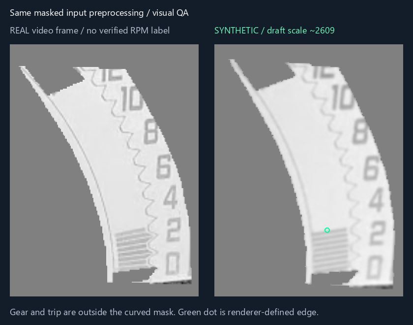

# Triumph RPM training pilot

[Open the Colab notebook](https://colab.research.google.com/github/sainadh812/triumph-speedometer-dataset/blob/main/rpm_training_v1/Triumph_RPM_Training_V1_Colab.ipynb).

This separate experiment learns the LCD tachometer's filled-bar position. The existing analog speedometer model is unchanged. It uses **2,000 OpenCV-generated images**, without ImageGen or new paid generation services.

## Dataset

| Split | Images | Readable rendered targets | Unresolved examples |
|---|---:|---:|---:|
| Training | 1,600 | 1,280 | 320 |
| Validation | 400 | 320 | 80 |

Inputs are **256 pixels high × 192 wide**, single-channel grayscale. Registration first aligns the LCD to the reference view. Shared preprocessing preserves the curved RPM strip and printed scale; gear, trip, clock and fuel regions are hidden at gray value 128. The same preprocessing is required for real-video inference.

The renderer adds sloped LCD stripes to real baseline backgrounds, with a known upper edge and approximate indicated RPM from the draft printed-scale calibration. It varies brightness, contrast, shading, noise, blur, compression, small rotation, translation, scale, shear and perspective. Image geometry and edge coordinates receive the same transform. Printed scale text is not mirrored. Unresolved examples include no clear fill, edge occlusion, severe blur and washout, with null numeric targets.

There are 400 procedural families, each with five variants. Whole families are assigned to a split before augmentation, using different baseline/appearance source frames for train and validation. **All backgrounds still come from one short recording of the same dashboard**: these splits do not establish independent real-video accuracy. There are also 19 aligned real development frames, excluded from training and validation, with no numeric ground truth.

Positive render targets span approximately 500–9,500 RPM on the draft scale. Running video evidence currently covers only the lower range, approximately 0–3,500 RPM. Fine-segment pitch and precise physical RPM calibration remain unverified; rendered upper-range examples are procedural extrapolation, not high-RPM measurements. Previous prototype estimates were not promoted to ground-truth labels.

## Model and external gates

A compact CNN predicts normalized fill position and an uncalibrated readability score. Fill regression uses readable rows only; negatives never imply zero RPM. Multiplying predicted fill by 12,000 uses the draft scale and yields an approximate indicated reading.

LCD localization uses the existing static-feature registration prototype. A separate full-LCD state check suppresses startup, dark, blank and uncertain frames. This is essential: a startup animation can look like a running RPM bar after cropping. The strip model is not trained to solve that impossible distinction. EN-OFF remains a separate message and does not force zero while residual segments are visible.

This model starts fresh, with random weights; speedometer checkpoints are incompatible. Initial training is 20 epochs, batch size 32, with early stopping after eight epochs without improvement.

## Colab and restart

The notebook downloads code from an immutable Git commit and verifies the dataset archive and every label/image checksum. Use a T4 GPU and connect Drive. Checkpoints are written under:

`MyDrive/SpeedometerTraining/experiments/triumph_rpm_strip_v1/runs/`

| Mode | Behavior |
|---|---|
| `fresh` | New run, random weights, previous runs preserved |
| `latest` | Restore latest compatible completed epoch |
| `best` | Restore best compatible epoch and its matching optimizer |
| `explicit` | Restore the full checkpoint at the supplied path |

Epoch 0 and every completed epoch save model, optimizer, scheduler, AMP scaler, RNG states, loader RNG, history and dataset/code identity. Writes are flushed, atomically renamed, hashed and marked complete. Resume validates the checkpoint rather than silently falling back to fresh training. EPOCHS means total target epoch, not additional epochs. The exported `best_model.pt` is for inference; resume uses the full epoch checkpoint.

## Metrics and next decision

- Fill-fraction MAE: average position error on all readable validation targets; lower is better.
- Approximate RPM MAE: fill MAE × 12,000, expressing agreement with the draft synthetic labels.
- Readability balanced accuracy: ability to accept readable and reject unresolved examples without favoring the majority class.
- Coverage: proportion receiving a number; this is not accuracy.

Model selection combines fill error on every readable target and readability loss on all examples. Real development predictions are shown separately for visual review and have no computed accuracy. An independent recording with checked RPM labels is needed before claiming real-camera performance.

## Reproducibility

`prepare_dataset.py` and `preprocess.py` define rendering and model input. `calibration/` records reference points and source-asset provenance. `data_download_manifest.json` protects the published archive. `train_rpm.py` defines the model and resumable training. The notebook pins OpenCV 4.14.0 and NumPy 2.1.3; checkpoints also record and verify the training runtime.

The local source generator expects the project's RPM prototype review assets; the published dataset and Colab notebook are usable without the original videos. Source material is the user's dashboard recording. No license for third-party underlying imagery is asserted by this RPM update.

## First Colab pilot result

The initial T4 run completed on 2026-10-17, stopping early at epoch 17; the combined selection score chose epoch 9. The training cell took 49 seconds. All 18 initial/epoch checkpoints passed the Drive hash audit, and best/latest full states loaded successfully.

| Synthetic validation metric | Best selected model |
|---|---:|
| Approximate indicated RPM MAE | 135.97 RPM |
| Approximate indicated RPM 95th-percentile absolute error | 352.28 RPM |
| Readability balanced accuracy | 95.16% |
| Readable-target recall | 99.06% |
| Unreadable-target specificity | 91.25% |

The 19 real development frames yielded nine tentative readings, four low-readability abstentions, and six external-state suppressions. This is coverage, not real accuracy. A visual comparison against five pre-existing broad RPM brackets found one reading outside its bracket (frame 338: approximately 3,194 versus 1,000–3,000); these brackets are not measured engine RPM. Calibration and independent real-video evaluation remain necessary.
